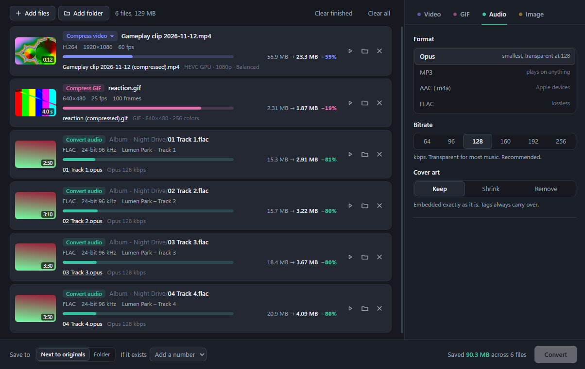

# Converter

A small Windows app for everyday media shrinking: compress videos, squeeze GIFs, and turn FLAC albums into Opus
with every tag and the cover art intact. It's a friendly front-end for ffmpeg and opusenc, so you never have to
remember the command lines.



## Install

1. Download **Converter-Setup-x.y.z.exe** from the [latest release](https://github.com/sttsspjy/converter/releases/latest).
2. Run it. It installs for your user only, so no admin rights are needed.
   The installer isn't code-signed, so Windows may say *"Windows protected your PC"*: click **More info → Run anyway**.
3. On first launch, click **Download**. Converter fetches ffmpeg and opusenc (about 95 MB) from their official
   builds, checks them against fixed SHA-256 hashes, and keeps them in its own folder. If ffmpeg is already on
   your PATH, it uses that instead.

Windows 10 or 11, 64-bit. Updates install over the top, and the app tells you when a new version is out.
Uninstall from *Settings → Apps*.

## What it does

Drop files or whole folders on the window, or select them in Explorer and use **Send to → Converter**.
Every file gets a sensible task, and each task has its own settings panel.

**Videos**
- **Keep the look**: the smallest file at a chosen quality level, or **Fit a file size**: 10 / 25 / 50 / 100 / 500 MB
  presets (hello, Discord) or any size. 2-pass, re-encoded automatically if the first try lands over.
- HEVC, H.264 or AV1, on an NVIDIA GPU (NVENC) or the CPU.
- Cap the resolution (4K → 1080p and so on; portrait clips are handled) and frame rate, and trim with a visual scrubber.
- When a size target is tight, it lowers the resolution itself so the result stays sharp instead of blocky.
- Keeps 10-bit, every audio track, chapters and metadata. MKV keeps subtitles too.

**GIFs**
- Palette-optimized re-encode with control over size, frame rate, colors and dithering.
- Optional lossy compression with gifsicle (one-click download), and "keep it under N MB".
- Or switch the output to animated WebP or MP4, which is often many times smaller. Videos can be turned into GIFs too.

**Music**
- FLAC/WAV → Opus through the official `opusenc`, so tags and embedded cover art carry over untouched, Unicode included.
  Also MP3, AAC and FLAC output, from any input.
- Drop an album folder to convert every track. Saving to another folder mirrors the folder structure and brings
  `cover.jpg`/`folder.jpg` along.
- Cover art can be kept, shrunk to 800 px, or removed.

**Images**: WebP, AVIF, JPG or PNG, with quality and maximum size.

**And around it all:** before/after sizes for every file, estimates before you start, a queue that keeps the
GPU busy with one video while several audio tracks encode in parallel, and output written next to the originals
or to a folder you pick. Nothing is ever overwritten silently, and cancelled jobs leave no half-written files behind.

## Where things live

| What | Where |
| --- | --- |
| The app | `%LOCALAPPDATA%\Programs\Converter` |
| Downloaded ffmpeg / opusenc / gifsicle | `%LOCALAPPDATA%\Converter\tools` (removed on uninstall) |
| Settings | `%APPDATA%\Converter\settings.json` |
| Log | `%LOCALAPPDATA%\Converter\converter.log` |

Converter only goes online to fetch those tools (from github.com/GyanD, archive.mozilla.org and
eternallybored.org, each pinned to a version and checksum) and to check GitHub for a newer release.

## Building from source

Needs Python 3.11+ and, for the installer, [Inno Setup 6](https://jrsoftware.org/isinfo.php).

```powershell
python -m venv .venv
.venv\Scripts\pip install -r requirements.txt pyinstaller
.venv\Scripts\python app.py                                # run it
.venv\Scripts\python -m unittest discover -s tests        # tests (the encode tests need ffmpeg + opusenc)
.venv\Scripts\python packaging\build.py                    # dist\Converter-Setup-<version>.exe
```

`setup.ps1` sets up a source checkout for daily use, with Start menu and *Send to* shortcuts, if you'd rather not
use the installer. Pushing a `v*` tag builds the installer on GitHub Actions and publishes a release.

Code map: `converter/tasks.py` holds what each task does, `converter/jobs.py` is the queue,
`converter/fetch.py` downloads the tools, `converter/api.py` is what the UI calls, and `ui/` is plain
HTML/CSS/JS with no build step.

## License

MIT. ffmpeg (GPL), opus-tools (BSD) and gifsicle (GPL) are separate programs under their own licenses. Converter
downloads them from their publishers and doesn't ship them.
